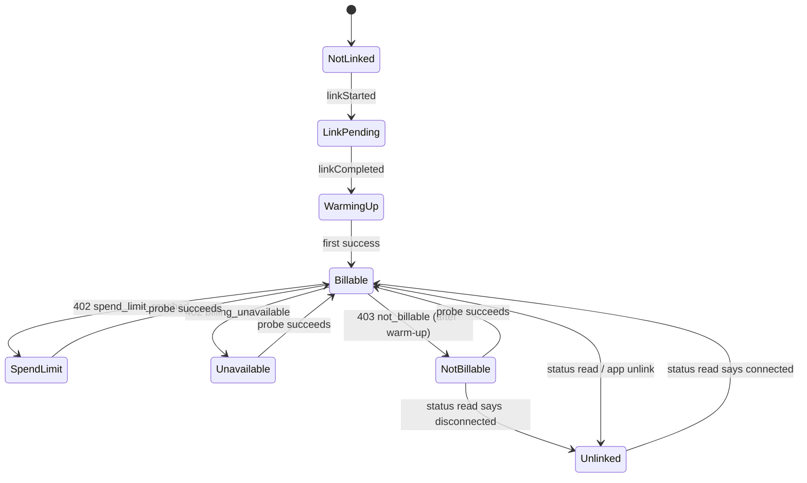

# LinkedBilling

**Let your B2B customers' Claude organizations pay for your iOS app's AI features, without a billing error ever reaching a user.**

On 17 November 2026 Anthropic opened **Linked billing** in beta ([release notes](https://platform.claude.com/docs/en/release-notes/overview), [docs](https://platform.claude.com/docs/en/manage-claude/oauth-apps/organization-billing-connections)). A customer's admin links their Claude organization to your app through OAuth and sets a monthly spend cap. After that, each `/v1/messages` call can carry `billing_policy: { bill_to: "user_profile" }`, and the customer's org pays instead of you.

Sending that field is the easy part. This package handles what the docs warn you about:

| What the API won't tell you | What happens if you ignore it | What this package does |
|---|---|---|
| A customer unlinked you in the Console. **There is no webhook and no email.** | Every request for that customer fails with 403 until someone notices. | A `ConnectionReconciler` reads `connection_status` on a phase-aware, jittered schedule. A `not_billable` refusal triggers an immediate read. |
| How much of their spend cap is left. **You can't read the cap at all.** | You hit 402 mid-session. Or, after the first 402, you stop billing them until the 1st and quietly pay for a month. | A probe: after `spend_limit_reached`, exactly one request tests the customer again after 15 min (doubling on each failure), and never later than 00:00 UTC on the 1st. |
| Who actually paid. **A successful response doesn't say.** | Your usage screen and your own subsidy budget are guesses. | A `SpendLedger` records every decision and outcome. Budgets count in-flight reservations, so a burst can't overshoot them. |
| Whether a new link works yet. **It can take ~10 s.** | The first request after "Link" fails and the customer's state flips to "broken". | A warm-up window: a `not_billable` inside it is retried once instead of degrading the link. |
| Whether code execution can be billed to the customer. **It can't (400).** | A feature that works for you breaks for every linked customer. | The router never bills the customer for a code-execution feature. |
| Whether an App Store subscriber is also paying through their org. | You charge the same usage twice. | Usage covered by the App Store subscription is always app-paid first. The linked org pays only beyond that allowance. |

## Why this matters

"Who pays for inference" is an architecture decision, not a pricing slide. Once it can change per request, every layer is affected: auth (an OAuth link the app starts and the back end completes), routing (a decision that depends on plan, link health and budgets), failure semantics (three new refusals, each needing a different response) and state (a link that can end without any notification). Teams that treat it as a header flag find that out one support ticket at a time.

The design here is the one I'd defend in a staff-level review. It uses a pure decision core, one actor that owns all mutable state, explicit ordering for results that arrive late, and a test suite that is checked against deliberately broken implementations.

## How it fits together

```mermaid
flowchart LR
    subgraph iOS app
      UI[Feature screen] -->|InferenceRequest| API[Your back end]
      LS[LinkSession<br/>validates OAuth callback] -->|one-time code| API
    end
    subgraph Swift back end
      API --> GW[LinkedBillingGateway<br/>actor: LinkState + SpendLedger]
      GW --> R[BillingRouter<br/>pure function]
      GW -->|bill_to: user_profile / self| T[MessagesTransport → /v1/messages]
      RC[ConnectionReconciler] -->|connection_status| GW
    end
```

The iOS app never holds the operator credential. It runs the link flow (`LinkSession`) and shows state. The gateway, router and reconciler are plain Swift with no Apple-only imports, so they run in a Swift back end (Vapor, Hummingbird) and in the app's tests. The [demo app](#demo-app) runs them in-process against a simulated API.

### Who pays: the router

`BillingRouter.route(...)` is a pure function. First match wins:

1. **App's own usage → app.** Evals, moderation and onboarding are never billed to a customer (the docs require this).
2. **Covered by the App Store subscription → app**, until the monthly allowance is used up.
3. **Code execution → app** (from the subsidy budget), or pause. The API won't bill a customer for it.
4. **Customer's org can pay → customer.** That means `admit`, or the one due `probe`.
5. **Org can't pay → subsidy**, on a cheaper model, if the feature and plan qualify and the reservation fits the monthly budget.
6. **Otherwise → pause**, with a reason the UI can act on ("ask your admin to raise the cap", "relink").

### Link health: the state machine



`LinkState` is a synchronous value type with no I/O and no clock (callers pass `now`). Its invariants are listed in the source, and each one has a test and a mutant:

1. A result issued before the latest link/unlink action never changes state.
2. Of two request outcomes, the one **issued** later wins. Arrival order doesn't decide it. A stale success can't clear a newer refusal, and a stale refusal can't undo a newer recovery.
3. While degraded, at most one probe is in flight. A probe that never reports expires after 2 minutes.
4. A spend-limit probe is never scheduled after 00:00 UTC on the 1st.
5. `connection_status: unknown` never changes state. `connected` never overrides health observed from requests (the docs say `connected` "doesn't promise that a request will succeed").

## Design decisions and trade-offs

- **Ordering by ticket, not by timestamp.** Every request, status read and link action takes a `Ticket` from the same counter before it suspends. Wall-clock timestamps can tie, go backwards, or come from a different machine. The ticket makes "issued later" well defined, and that is what makes actor reentrancy safe. *Rejected:* serialising all requests per customer, which is correct but turns one slow call into head-of-line blocking for the whole customer.
- **One actor owns all mutable state.** Routing, reservation and state transitions happen in one actor turn. The only suspension points are the transport call and retry sleeps. *Rejected:* separate actors for state and ledger, which reintroduces a check-then-act race between "can the customer pay?" and "reserve the subsidy".
- **Reservations, not post-hoc accounting.** A subsidy decision reserves its estimate before sending, and settles to the actual cost after. *Trade-off:* a request that fails with an unknown outcome releases its reservation and counts as "unknown" rather than spent, so the ledger can under-count in that rare case. It never over-counts.
- **Probe, don't wait.** The cap is unreadable, so the design pays a small cost (one customer-billed request every 15 min to 6 h while capped) to avoid subsidising a customer who has already raised their cap. *Rejected:* waiting for the month boundary (expensive), and probing every request (it multiplies refused calls and log noise).
- **Fail loudly on caller bugs.** `400 user_profile_required`, other 400s and unknown 403s are returned as `.failed(.rejected)`. They are never covered up by quietly re-sending as `bill_to: "self"`. Falling back there would hide a broken integration behind your own credit card.
- **Transport errors are not retried.** "Sent, outcome unknown" could mean the request was served and billed. Re-sending could bill twice, so the gateway reports it and the ledger records `unknown`.
- **UTC month boundaries by integer civil-calendar arithmetic** (Hinnant's algorithms), not `Calendar`. A device-local time zone would shift every cap reset by hours.
- **Saturating arithmetic throughout.** Costs, budgets, backoffs and timestamps clamp at `Int64` bounds instead of trapping. Hostile inputs (a `retry-after` of `99999999999999999999`, a policy of `Int64.max` ms) are covered by tests.

## Verification

- **101 XCTest tests.** They cover the state machine invariants, the documented error shapes (including a bare 403 that must *not* read as "unlinked"), the router's precedence table, the ledger's reservation and month-boundary behaviour, the gateway's fallbacks and retries, actor-reentrancy races driven by a transport the test controls, single-flight reconciliation, OAuth callback validation, and one end-to-end month.
- **43 mutants** in [`scripts/mutation-check.sh`](scripts/mutation-check.sh). Each one puts back a specific bug that this README says the design prevents, for example "drop the stale-success guard" or "stop counting reservations". CI fails if any mutant survives, so every claim above is backed by a test that fails without it.
- **CI** ([Actions](../../actions)) runs a clean Linux build and tests on Swift 6.0 with warnings as errors, macOS tests plus a generic iOS Simulator build of both products, and the mutation check.

## Honest limits

- **The API is a beta,** and this package models it as documented in November 2026. The billing beta header's value is passed in by you, not hard-coded. `/v1/chat/completions` (which returns the same statuses without the error code) isn't decoded here.
- **The simulator is not the API.** `SimulatedClaudeOrg` follows the documented checks closely enough to exercise every branch. It is not a substitute for testing with a second organization on your app's *Test users* list.
- **One gateway per customer, in memory.** A multi-instance back end needs the `LinkState` and ledger in shared storage with the same ticket discipline (for example a per-profile row with a version column). That's the next step, not something this package claims.
- **No eligibility pre-check.** Orgs that are marketplace-billed or subscription-only, and customers needing HIPAA/FERPA/CMEK coverage, can't be billed this way. The package can't detect those from your side; the docs say neither can the API. Ineligible orgs show up as `not_billable` and are handled as such. Keep compliance-bound customers out of linking in your product.
- **Estimates are yours.** Budget checks use the estimate you pass (for example from `count_tokens`). A reply much longer than estimated settles at its real cost and can take a budget slightly past its limit, once.
- **Token-scoped auth isn't modelled.** If you turn on "Disable operator-only tokenless authentication", customer requests must use each connection's access token. The routing still applies, but the transport has to pick the right credential.

## Use it

```swift
.package(url: "https://github.com/rajatslakhina/linked-billing-kit.git", from: "1.0.0")
```

```swift
import LinkedBilling

let gateway = LinkedBillingGateway(
    profile: UserProfileID("uprof_01HV9Z"),
    plan: .subscription(includedPerMonth: .dollars(1)),        // from StoreKit
    policy: RoutingPolicy(subsidyPerMonth: .dollars(3)),
    transport: AnthropicTransport(),                           // your /v1/messages client
    clock: SystemClock(), sleeper: TaskSleeper())

let summarize = FeatureDescriptor(
    id: "summarize", displayName: "Summarize thread", model: "claude-opus-5-5",
    subsidyModel: SubsidyModel("claude-haiku-4-5", costPercent: 20))

let result = await gateway.send(InferenceRequest(feature: summarize, estimate: estimate, prompt: text))
if result.statusCheckRecommended { _ = await reconciler.reconcileNow() }
```

`AnthropicTransport`, `SystemClock` and `TaskSleeper` are yours to write: one `/v1/messages` call using `BillingEnvelope(payer:betaHeaderValue:)` for the headers and body field, `Date()` in milliseconds, and `Task.sleep`.

## Demo app

Demo app: (added after the companion repo is pushed — see below)

## License

MIT
