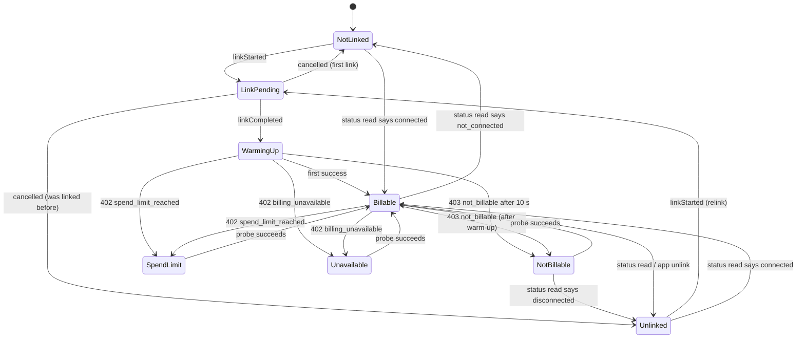

# LinkedBilling

**Let your B2B customers' Claude organizations pay for your iOS app's AI features, and turn every linked-billing refusal into either a fallback or a pause your UI can explain.**

(The refusals are 402 `spend_limit_reached`, 402 `billing_unavailable` and 403 `not_billable`. Caller bugs and 503s that are still failing after their retries fail loudly instead of being hidden.)

<p align="center">
  
  
</p>

On 17 November 2026 Anthropic opened **Linked billing** in beta ([release notes](https://platform.claude.com/docs/en/release-notes/overview), [docs](https://platform.claude.com/docs/en/manage-claude/oauth-apps/organization-billing-connections)). A customer's admin links their Claude organization to your app through OAuth and sets a monthly spend cap. After that, a `/v1/messages` call that carries `"billing_policy": {"type": "billing_policy", "bill_to": "user_profile"}`, the `anthropic-user-profile-id` header and the `user-profiles-billing-2026-10-01` beta is paid for by the customer's org instead of you.

Sending that field is the easy part. This package handles what the docs warn you about:

| What the API won't tell you | What happens if you ignore it | What this package does |
|---|---|---|
| A customer unlinked you in the Console. **There is no webhook and no email.** | Every request for that customer fails with 403 until someone notices. | `ConnectionReconciler` reads `connection_status` (single-flight) and gives you a phase-aware, jittered delay to poll on. After a `not_billable`, `GatewayResult.statusCheckRecommended` tells you to call `reconcileNow(fresh: true)`. |
| How much of their spend cap is left. **You can't read the cap at all.** | You hit 402 mid-session. Or, after the first 402, you stop billing them until the 1st and quietly pay for a month. | A probe: after `spend_limit_reached`, one request at a time tests the customer again, first after 15 min (doubling on each failure) and never later than 00:00 UTC on the 1st. A probe that doesn't report within its timeout is replaced. |
| Who actually paid. **A successful response doesn't say.** | Your usage screen and your own subsidy budget are guesses. | A `SpendLedger` records every decision and outcome. Budgets count in-flight reservations, so a burst can't overshoot them on its estimates. A reply that costs more than its estimate still can (see Honest limits). |
| Whether a new link works yet. **It can take ~10 s.** | The first request after "Link" fails and the customer's state flips to "broken". | A warm-up window: a `not_billable` inside it is retried once instead of degrading the link. |
| Whether code execution can be billed to the customer. **It can't (400).** | A feature that works for you breaks for every linked customer. | The router never bills the customer for a code-execution feature. |
| Whether an App Store subscriber is also paying through their org. | You charge the same usage twice. | Usage covered by the App Store subscription is always app-paid first. The linked org pays only beyond that allowance. |

## Why this matters

"Who pays for inference" is an architecture decision, not a pricing slide. Once it can change per request, every layer is affected: auth (an OAuth link the app starts and the back end completes), routing (a decision that depends on plan, link health and budgets), failure semantics (three new refusals, each needing a different response) and state (a link that can end without any notification). Teams that treat it as a header flag find that out one support ticket at a time.

The design uses a pure decision core, one actor that owns all mutable state, and explicit ordering for results that arrive late. Every concurrency and money claim below is pinned by a test, and each of those tests is checked against a deliberately broken implementation (the mutation check, run in CI; see [Verification](#verification)).

## How it fits together

```mermaid
flowchart LR
    subgraph iOS app
      UI[Feature screen] -->|InferenceRequest| API[Your back end]
      LS[LinkSession<br/>validates OAuth callback] -->|one-time code| API
    end
    subgraph Swift back end
      API --> GW[LinkedBillingGateway<br/>actor: LinkState + SpendLedger]
      GW --> R[BillingRouter<br/>pure function]
      GW -->|bill_to: user_profile / self| T[MessagesTransport → /v1/messages]
      RC[ConnectionReconciler] -->|connection_status| GW
    end
```

The iOS app never holds the operator credential. It runs the link flow (`LinkSession`) and shows state. The gateway, router and reconciler are plain Swift with no Apple-only imports, so they run in a Swift back end (Vapor, Hummingbird) and in the app's tests.

Two products:

- **`LinkedBilling`**: the production library.
- **`LinkedBillingTesting`**: a deterministic `SimulatedClaudeOrg`, a `ManualClock`, and `ScriptedMonth`, the customer month the [demo app](#demo-app) plays. Link it from tests or demos, not production code.

### Who pays: the router

`BillingRouter.route(...)` is a pure function. First match wins:

1. **App's own usage → app.** Evals, moderation and onboarding are never billed to a customer (the docs require this), and are sent without the customer's profile header so the Console doesn't attribute them to that customer.
2. **Covered by the App Store subscription → app**, until the monthly allowance is used up.
3. **Code execution → app**, on the feature's own model, from the subsidy budget, or pause. The API won't bill a customer for it.
4. **Customer's org can pay → customer.** That means `admit`, or the one due `probe`.
5. **Org can't pay → subsidy**, on a cheaper model, if the feature and plan qualify and the reservation fits the monthly budget.
6. **Otherwise → pause**, with a reason the UI can act on ("ask your admin to raise the cap", "relink").

### Link health: the state machine (main paths)



`LinkState` is a synchronous value type with no I/O and no clock (callers pass `now`). Its invariants are listed in the source, and each one has a test and a mutant:

1. A result issued before the latest link/unlink action never changes state. The one exception is permanent: a stale `disconnected` read still records that the profile was once linked, which decides whether a cancelled or expired flow reads as "not linked" or "unlinked", so that answer doesn't depend on when the read lands either.
2. Of two request outcomes, the one **issued** later wins. Arrival order doesn't decide it. A stale success can't clear a newer refusal, and a stale refusal can't undo a newer recovery.
3. While degraded, at most one probe is in flight. A refusal from an older, non-probe request doesn't cancel it. A probe that never reports expires after `probeTimeoutMillis` (10 min by default; keep it above your transport's request timeout).
4. A spend-limit probe is never scheduled after 00:00 UTC on the 1st.
5. `connection_status: unknown` never changes state. `connected` never overrides health observed from requests (the docs say `connected` "doesn't promise that a request will succeed"). A `disconnected` or `not_connected` read issued before a request that proved the connection alive (a success, or a 402: the docs refuse ended connections with 403 `not_billable`, so a 402 is taken as proof the connection was alive) doesn't unlink. Between a negative read and any proof the connection was alive (a success, a 402, or a `connected` read), the one *issued* later decides, in any arrival order.

## Design decisions and trade-offs

- **Ordering by ticket, not by timestamp.** Every request, status read and link action (including the expiry of an abandoned flow) takes a `Ticket` from the same counter before it suspends. The one deliberate exception is a link start on a link that already reads as linked (a scope re-approval): it changes nothing and takes no ticket, so requests and reads in flight still count. The expiry is folded in by `LinkState.settle(at:)` before any later ticket is issued, so a read that starts after a flow expired always counts. Wall-clock timestamps can tie, go backwards, or come from a different machine. The ticket makes "issued later" well defined, so a result that lands after an actor suspension can't undo newer evidence. *Trade-off:* ticket order is the client's issue order, not the server's processing order. See the limits below. *Rejected:* serialising all requests per customer, which is correct but turns one slow call into head-of-line blocking for the whole customer.
- **One actor owns all mutable state.** Routing, reservation and state transitions happen in one actor turn. The only suspension points are the transport call and retry sleeps. *Rejected:* separate actors for state and ledger, which reintroduces a check-then-act race between "can the customer pay?" and "reserve the subsidy".
- **Reservations, not post-hoc accounting.** An app-paid decision reserves its estimate before sending, and settles to the actual cost after. *Trade-off:* a request whose transport fails releases its reservation and is recorded as "unknown", not spent. If the server actually served it, the ledger under-counts by its real cost.
- **Probe, don't wait.** The cap is unreadable, so the design pays a small cost (one customer-billed request every 15 min to 6 h while capped) to avoid subsidising a customer who has already raised their cap. *Rejected:* waiting for the month boundary (expensive), and probing every request (it multiplies refused calls and log noise).
- **Probing past "not retryable", on purpose.** The docs call `billing_unavailable` not retryable, and say retrying `not_billable` "doesn't change the result until the cause is fixed". Both causes can be fixed without telling you: credit gets bought, billing gets set up, eligibility changes. So the package probes those too, but slowly (30 min, doubling to 6 h). The cost is a refused, unbilled request in your logs every few hours per affected customer.
- **Fail loudly on caller bugs.** `400 user_profile_required`, other 400s and unknown 403s are returned as `.failed(.rejected)`. They are never covered up by quietly re-sending as `bill_to: "self"`. Falling back there would hide a broken integration behind your own credit card.
- **Transport errors are not retried.** "Sent, outcome unknown" could mean the request was served and billed. Re-sending could bill twice, so the gateway reports it and the ledger records `unknown`.
- **UTC month boundaries by integer civil-calendar arithmetic** (Hinnant's algorithms), not `Calendar`. A device-local time zone would shift every cap reset by hours.
- **Saturating arithmetic throughout.** Costs, budgets, backoffs and timestamps clamp at `Int64` bounds instead of trapping. Hostile inputs are covered by tests: a policy of `Int64.max` ms clamps, and a `retry-after` of `99999999999999999999` clamps to an hour (so it is never retried sooner than a smaller value would be).

## Verification

- **147 XCTest tests.** They cover the state machine invariants, the documented error shapes (including a bare 403 that must *not* read as "unlinked"), the router's precedence table, the ledger's reservation and month-boundary behaviour, the gateway's fallbacks and retries, actor-reentrancy races driven by a transport the test controls, single-flight reconciliation, OAuth callback validation, and the scripted month end to end.
- **86 mutants** in [`scripts/mutation-check.sh`](scripts/mutation-check.sh). Each one puts back a specific bug that this README says the design prevents, for example "drop the stale-success guard" or "stop counting reservations". CI fails if any mutant survives or makes the suite hang, so each listed mutant makes the suite fail rather than pass or hang.
- **CI** ([Actions](../../actions)) runs a clean Linux build and tests on Swift 6.0 with warnings as errors, macOS tests plus a generic iOS Simulator build of both products, and the mutation check.
- **The scripted month the demo plays is tested directly** (`ScriptedMonthTests`), so the numbers in the demo's screenshots are asserted, not hand-copied.

## Honest limits

- **The API is a beta,** and this package models it as documented in November 2026. `BillingEnvelope.billingBeta` is the documented beta value; pass a newer one when it changes. `/v1/chat/completions` (which returns the same statuses without the error code) isn't decoded here.
- **The simulator is not the API.** `SimulatedClaudeOrg` follows the documented checks closely enough to exercise every branch. It is not a substitute for testing with a second organization on your app's *Test users* list.
- **One gateway per customer, in memory.** A restart loses month-to-date totals, so the included and subsidy budgets start again from zero. A multi-instance back end needs the `LinkState` and ledger in shared storage with the same ticket discipline (for example a per-profile row with a version column). That's the next step, not something this package claims.
- **Client order, not server order.** For two customer requests in flight together, the server may process them in the opposite order to their tickets. A late success can then briefly mark a capped link billable. That costs one refused (unbilled) request for each request sent in that window, and resets the probe backoff, before the state corrects itself.
- **Batches and streaming aren't modelled.** Message Batches can't bill a customer (the docs say such requests are refused), and the router doesn't know about batches: send them as app-paid. A `billing_unavailable` that arrives mid-stream comes as an error event after a 200, and your transport has to map it to `.refused(.billingUnavailable, partialReply:)`.
- **Only Anthropic's `503 overloaded_error` is retried**, and only while each wait fits `RetryLimits.maxRetryWaitMillis` (30 s by default). A longer `retry-after` fails the request as `.overloaded` instead of holding the caller. A 503 without that error type (a proxy, a load balancer) may have taken effect, so it decodes to `.other` and isn't retried. 429 and 529 also decode to `.other`. Put your general rate-limit retry policy in the transport.
- **The OAuth redirect must be https on your proven domain** (docs: every redirect URI is on the domain you prove, except `localhost`). On iOS, `ASWebAuthenticationSession` can receive an https callback with `.https(host:path:)` from iOS 17.4; on 17.0–17.3, let your back end receive the callback and validate `state` there with the same checks. `LinkSession` validates whichever redirect you register; the demo and tests use an https one.
- **An abandoned link flow expires.** Nothing tells the app when a user closes the sign-in sheet, so a pending link is treated as abandoned after `LinkPolicy.pendingTimeoutMillis` (10 min, the pushed request's lifetime). Read `LinkState.phase(at:)` or `LinkedBillingGateway.currentPhase()` for UI (they also end the ~10 s warm-up on time); `phase` itself only moves when an event is applied.
- **Two orderings around a link flow's start are settled by a fresh read, not by tickets.** Starting a flow doesn't change the connection a read in flight is reporting on, so: a `connected` read issued just before the start links the profile if it lands first and is stale if it lands after; and a negative read issued just before a re-approval of a link that still reads as linked either unlinks it before the flow starts (the flow then reads "linking") or unlinks it during the flow. Neither ever leaves the customer billed by mistake, and completing the flow gives the same state in every order. After a cancel, call `reconciler.linkCancelled()` (it applies the cancel and takes a fresh read). After an expiry, the reconciler's `nextDelay` wakes at the expiry while a flow is pending, so the polling loop below takes that fresh read without a separate timer.
- **"A 402 proves the connection was alive" is an inference.** The docs say an ended or unlinked connection is refused with 403 `user_profile_not_billable`; they don't spell out the order of the server's checks. The unlink logic relies on that reading.
- **`LinkSession` trusts one clock.** Pass `createdAt` from the same clock you pass as `now`. A 60 s tolerance absorbs small adjustments; a back-end timestamp on a device whose clock is minutes behind would expire the callback.
- **A link found by a status read skips the warm-up.** If `connection_status` reports `connected` for a customer the gateway thought was unlinked (they linked elsewhere), the first `not_billable` inside ~10 s degrades the link instead of being retried.
- **App-side unlink is assumed to succeed.** `LinkEvent.unlinkedByApp` should be applied after `POST /v1/user_profiles/{id}/unlink` returns 200. The docs' partial-unlink-on-503 recovery is yours to implement.
- **No eligibility pre-check.** Orgs that are marketplace-billed or subscription-only, and customers needing HIPAA/FERPA/CMEK coverage, can't be billed this way. The package can't detect those from your side; the docs say neither can the API. Ineligible orgs show up as `not_billable` and are handled as such. Keep compliance-bound customers out of linking in your product.
- **Estimates are yours.** Budget checks use the estimate you pass (for example from `count_tokens`). A reply longer than estimated settles at its real cost, so it can push a budget past its limit, and several concurrent underestimated requests can each do so.
- **Token-scoped auth isn't modelled.** If you turn on "Disable operator-only tokenless authentication", customer requests must use each connection's access token. The routing still applies, but the transport has to pick the right credential.

## Use it

```swift
.package(url: "https://github.com/rajatslakhina/linked-billing-kit.git", from: "2.6.0")
```

```swift
import LinkedBilling

let gateway = LinkedBillingGateway(
    profile: UserProfileID("uprof_01HV9Z"),
    plan: .subscription(includedPerMonth: .dollars(1)),        // from StoreKit
    policy: RoutingPolicy(subsidyPerMonth: .dollars(3)),
    transport: AnthropicTransport(),                           // your /v1/messages client
    clock: SystemClock(), sleeper: TaskSleeper())

let summarize = FeatureDescriptor(
    id: "summarize", displayName: "Summarize thread", model: "claude-opus-5-5",
    subsidyModel: SubsidyModel("claude-haiku-4-5", costPercent: 20))

// GET /v1/user_profiles/{id}?oauth_app_id=…, anthropic-beta: user-profiles-search-2026-08-30
let reconciler = ConnectionReconciler(gateway: gateway, source: ProfileStatusSource())

let result = await gateway.send(InferenceRequest(feature: summarize, estimate: estimate, prompt: text))
if result.statusCheckRecommended { _ = await reconciler.reconcileNow(fresh: true) }

// The user closed the sign-in sheet: apply the cancel and read the status afresh.
_ = await reconciler.linkCancelled()

// Background polling, on the reconciler's phase-aware, jittered cadence.
Task {
    while !Task.isCancelled {
        let delay = await reconciler.nextDelay(jitterDraw: .random(in: 0...UInt64.max))
        try await Task.sleep(for: .milliseconds(delay))
        _ = await reconciler.reconcileNow()
    }
}
```

`AnthropicTransport`, `ProfileStatusSource`, `SystemClock` and `TaskSleeper` are yours to write: one `/v1/messages` call using `BillingEnvelope(payer:profile:)` for the headers and body field (pass the profile even when the app pays: the docs ask for the profile header on every call for a linked customer, and it is what attributes app-paid usage to them in the Console) (decode refusals with `BillingRefusal.decode`), one user-profile read decoded with `ConnectionStatus.decode`, `Date()` in milliseconds, and `Task.sleep`.

## Demo app

Demo app: (added after the companion repo is pushed — see below)

## License

MIT
